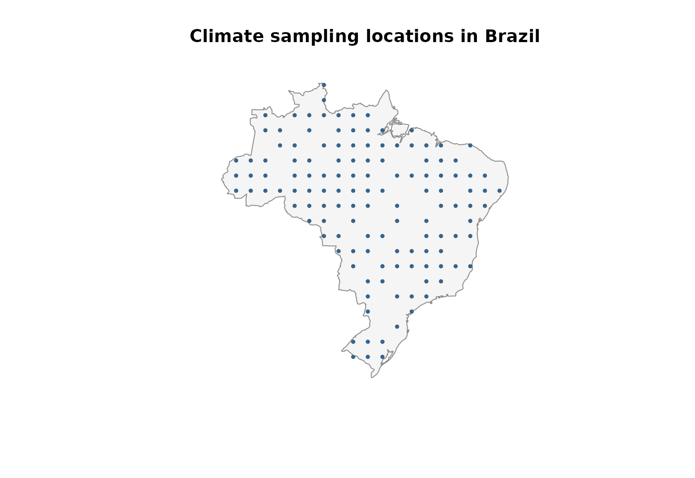
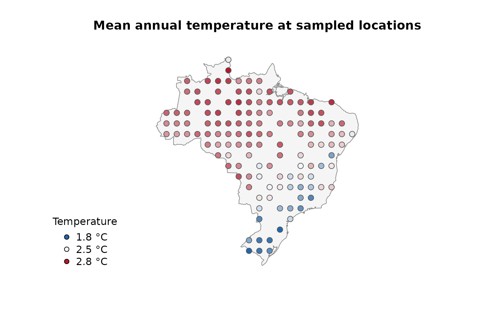
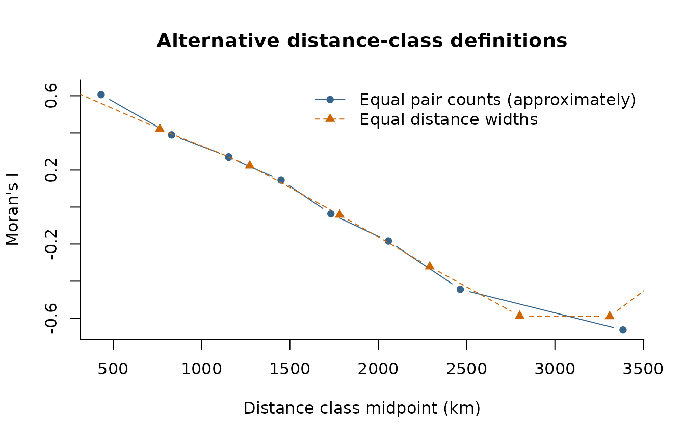
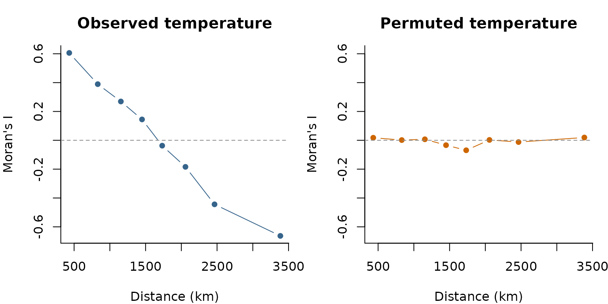

# Exploring autocorrelation across distances with lets.correl()

## Overview

Autocorrelation describes whether observations linked by a distance or
similarity relationship tend to have similar values. In macroecology,
autocorrelation is most commonly examined in geographical space, but the
underlying principle is not restricted to physical distance. For
example, we may ask whether species separated by short *phylogenetic
distances* have more similar trait values than distantly related
species, or whether the values of an ecological response are similar in
*environmental space*.

[`lets.correl()`](https://brunovilela.github.io/letsR/reference/lets.correl.md)
calculates Moran’s I over **distance classes**, producing a correlogram
rather than a single statistic. Its argument `y` is a square pairwise
distance matrix. The function does not use geographic coordinates
internally and can therefore be applied to geographical, phylogenetic,
environmental, functional, or other suitably defined distances.

This vignette uses mean annual temperature from the `temp` dataset
shipped with letsR. Locations are sampled within Brazil, and geographic
distances are calculated with
[`lets.distmat()`](https://brunovilela.github.io/letsR/reference/lets.distmat.md).
A precipitation layer supplied with letsR provides a second measured
variable for the multiple-variable example. The climate rasters are
derived from historical WorldClim data and are used here as an
illustration rather than an up-to-date climate assessment.

The workflow is:

1.  Select observations and extract their temperature values.
2.  Compute a geographic distance matrix (or supply another distance
    matrix).
3.  Calculate Moran’s I in successive distance classes.
4.  Inspect the autocorrelation pattern and compare variables or
    distance definitions.

## Moran’s I and distance classes

Moran’s I measures similarity between observations while accounting for
a distance-based weighting scheme. In a correlogram, the weights change
from one distance class to the next. Within each class, observations are
connected when their pairwise distance falls inside the corresponding
interval.

Positive Moran’s I indicates that connected locations tend to have
similar values. Negative Moran’s I indicates that connected locations
tend to have dissimilar values. Values near the expected value suggest
little detectable spatial autocorrelation at that distance, although
this is not evidence of spatial independence.

[`lets.correl()`](https://brunovilela.github.io/letsR/reference/lets.correl.md)
supports two class definitions:

- `equidistant = FALSE` (the default): class boundaries are quantiles of
  pairwise distances. Classes therefore contain approximately equal
  numbers of distance *pairs*, subject to tied distances.
- `equidistant = TRUE`: class boundaries have equal distance widths.
  Their numbers of pairs can differ considerably, particularly for
  irregularly distributed sampling locations.

The number of requested classes is set with `z`. An excessive number of
classes can yield intervals with too few connected locations to
calculate Moran’s I. Such intervals are omitted from the returned
matrix.

## Prepare temperature observations across Brazil

We sample locations inside Brazil’s national boundary and extract mean
annual temperature from the dataset included in letsR. Unlike a
simulated geographical gradient, these observations reflect spatial
heterogeneity in an empirical climate layer. The country boundary is
used solely to define the illustrative sampling region, not as an
ecological boundary.

``` r

library(letsR)
#> Loading required package: terra
#> terra 1.9.50
library(sf)
#> Linking to GEOS 3.14.1, GDAL 3.12.2, PROJ 9.7.1; sf_use_s2() is TRUE

data("temp", package = "letsR")
data("prec", package = "letsR")
temperature_raster <- terra::unwrap(temp)
precipitation_raster <- terra::unwrap(prec)

brazil <- rnaturalearth::ne_countries(
  country = "Brazil",
  scale = "medium",
  returnclass = "sf"
)

candidate_sites <- expand.grid(
  longitude = seq(-74, -34, by = 2),
  latitude = seq(-33, 5, by = 2)
)

candidate_sf <- st_as_sf(
  candidate_sites,
  coords = c("longitude", "latitude"),
  crs = 4326
)
inside <- lengths(st_within(candidate_sf, brazil)) > 0L
candidate_sites <- candidate_sites[inside, , drop = FALSE]

# Extract the bundled WorldClim-based layers at the retained sites.
# With a SpatVector of points, the first extract() column is an ID.
candidate_points <- terra::vect(st_as_sf(
  candidate_sites,
  coords = c("longitude", "latitude"),
  crs = 4326
))
candidate_sites$temperature_raw <- terra::extract(
  temperature_raster, candidate_points
)[[2]]
candidate_sites$precipitation_mm <- terra::extract(
  precipitation_raster, candidate_points
)[[2]]

# Retain sites with valid temperature and precipitation observations.
candidate_sites <- candidate_sites[
  is.finite(candidate_sites$temperature_raw) &
    is.finite(candidate_sites$precipitation_mm),
  , drop = FALSE
]

set.seed(42)
sites <- candidate_sites[
  sample.int(nrow(candidate_sites), min(130L, nrow(candidate_sites))),
  , drop = FALSE
]
rownames(sites) <- NULL

plot(st_geometry(brazil), col = "gray96", border = "gray55",
     main = "Climate sampling locations in Brazil")
points(sites$longitude, sites$latitude,
       pch = 16, cex = 0.65, col = "steelblue4")
```



Following the conversion used in letsR’s existing climate vignette, we
divide the stored temperature values by ten to express them in degrees
Celsius. If using a different temperature raster, check its original
scale and units rather than applying this conversion automatically.

``` r

sites$temperature_c <- sites$temperature_raw / 10

palette_temp <- grDevices::colorRampPalette(
  c("#2166AC", "#F7F7F7", "#B2182B")
)(100)
color_id <- cut(sites$temperature_c,
                breaks = 100, labels = FALSE, include.lowest = TRUE)

plot(st_geometry(brazil), col = "gray96", border = "gray55",
     main = "Mean annual temperature at sampled locations")
points(sites$longitude, sites$latitude,
       pch = 21, bg = palette_temp[color_id],
       col = "gray35", cex = 1.2)
legend("bottomleft", bty = "n", pch = 21,
       pt.bg = palette_temp[c(1, 50, 100)],
       legend = sprintf("%.1f °C", c(min(sites$temperature_c),
                                      median(sites$temperature_c),
                                      max(sites$temperature_c))),
       title = "Temperature")
```



``` r

summary(sites$temperature_c)
#>    Min. 1st Qu.  Median    Mean 3rd Qu.    Max. 
#>   1.780   2.342   2.535   2.441   2.609   2.773
```

The temperature values are empirical, although the sampling locations
are selected for the purposes of this tutorial. The resulting
correlogram is therefore a description of this particular set of
locations and should not be interpreted as a national estimate
independent of sampling design.

## Calculate geographical distances

[`lets.correl()`](https://brunovilela.github.io/letsR/reference/lets.correl.md)
requires a symmetric distance matrix whose rows and columns follow
exactly the same order as the observations in `x`. For the main example,
we calculate geodesic distances from longitude and latitude with
[`lets.distmat()`](https://brunovilela.github.io/letsR/reference/lets.distmat.md).
It returns distances in **metres** for geographical coordinates. We
convert them to kilometres to facilitate interpretation.

``` r

xy <- as.matrix(sites[, c("longitude", "latitude")])

distance_m <- lets.distmat(xy, asdist = FALSE)
distance_km <- distance_m / 1000

summary(distance_km[upper.tri(distance_km)])
#>    Min. 1st Qu.  Median    Mean 3rd Qu.    Max. 
#>   191.0   988.8  1581.0  1657.1  2231.8  4073.7
```

An object of class `dist`, such as `stats::as.dist(distance_km)`, is
also accepted. The numerical results do not depend on whether distances
are supplied as a square matrix or a `dist` object.

## Construct a Moran’s I correlogram

We begin with eight quantile-based distance classes. Set `plot = TRUE`
to produce the function’s built-in correlogram. Because we have
converted the distance matrix to kilometres, the axis labeled `Distance`
is expressed in kilometres in this example.

``` r

moran <- lets.correl(
  x = sites$temperature_c,
  y = distance_km,
  z = 8,
  equidistant = FALSE,
  plot = TRUE
)
```


``` r


round(moran, 3)
#>      Observed Confidence_Interval_(95%) Expected_value p_value Mean_Distance
#> [1,]    0.606                     0.056         -0.008   0.000       431.911
#> [2,]    0.389                     0.055         -0.008   0.000       830.823
#> [3,]    0.269                     0.056         -0.008   0.000      1154.132
#> [4,]    0.145                     0.056         -0.008   0.000      1450.237
#> [5,]   -0.037                     0.056         -0.008   0.302      1732.286
#> [6,]   -0.184                     0.056         -0.008   0.000      2057.676
#> [7,]   -0.444                     0.055         -0.008   0.000      2464.600
#> [8,]   -0.663                     0.046         -0.009   0.000      3385.561
#>      Count
#> [1,]  2114
#> [2,]  2092
#> [3,]  2086
#> [4,]  2098
#> [5,]  2098
#> [6,]  2100
#> [7,]  2090
#> [8,]  2092
```

The built-in correlogram connects the observed Moran’s I values and
displays vertical uncertainty bars. Its horizontal reference line shows
the expected value returned by the function. Positive Moran’s I at short
distances indicates that geographically nearby sampling locations tend
to have more similar temperatures. A decline with distance describes the
scale over which that similarity changes within the sampled Brazilian
locations.

### Understand the returned matrix

For a single variable,
[`lets.correl()`](https://brunovilela.github.io/letsR/reference/lets.correl.md)
returns a numeric matrix with six columns:

| Column | Interpretation |
|:---|:---|
| `Observed` | Calculated Moran’s I for each retained distance class |
| `Confidence_Interval_(95%)` | Approximate **half-width**, calculated as 1.96 times the estimated standard deviation, not the two interval endpoints |
| `Expected_value` | Expected Moran’s I under the function’s null reference |
| `p_value` | Two-sided normal-approximation p-value based on the analytical variance |
| `Mean_Distance` | **Midpoint of the distance-class boundaries**, not the arithmetic mean of observed pairwise distances |
| `Count` | Number of directed links in the binary distance weights. For symmetric distances, each unordered pair contributes twice |

For example, the approximate lower and upper limits can be reconstructed
as:

``` r

intervals <- data.frame(
  Distance_km = moran[, "Mean_Distance"],
  Moran_I = moran[, "Observed"],
  Lower = moran[, "Observed"] - moran[, "Confidence_Interval_(95%)"],
  Upper = moran[, "Observed"] + moran[, "Confidence_Interval_(95%)"]
)
round(intervals, 3)
#>   Distance_km Moran_I  Lower  Upper
#> 1     431.911   0.606  0.550  0.661
#> 2     830.823   0.389  0.334  0.445
#> 3    1154.132   0.269  0.213  0.325
#> 4    1450.237   0.145  0.089  0.200
#> 5    1732.286  -0.037 -0.093  0.019
#> 6    2057.676  -0.184 -0.240 -0.128
#> 7    2464.600  -0.444 -0.499 -0.389
#> 8    3385.561  -0.663 -0.709 -0.616
```

## Compare distance-class definitions

Quantile-based and equal-width classes answer related but distinct
questions. Quantile-based classes distribute the available pairs more
evenly, whereas equal-width classes make geographical intervals directly
comparable in kilometres. The second approach can generate sparse
classes at the extremes of the distance distribution.

``` r

moran_equalwidth <- lets.correl(
  x = sites$temperature_c,
  y = distance_km,
  z = 8,
  equidistant = TRUE,
  plot = FALSE
)

plot(moran[, "Mean_Distance"], moran[, "Observed"],
     type = "b", pch = 16, col = "steelblue4",
     xlab = "Distance class midpoint (km)",
     ylab = "Moran's I", bty = "l",
     ylim = range(c(moran[, "Observed"],
                    moran_equalwidth[, "Observed"])),
     main = "Alternative distance-class definitions")
lines(moran_equalwidth[, "Mean_Distance"],
      moran_equalwidth[, "Observed"],
      type = "b", pch = 17, lty = 2, col = "darkorange3")
legend("topright", bty = "n", pch = c(16, 17), lty = c(1, 2),
       col = c("steelblue4", "darkorange3"),
       legend = c("Equal pair counts (approximately)",
                  "Equal distance widths"))
```



Differences between the curves do not imply that one is intrinsically
correct and the other is wrong. They arise because Moran’s I is being
calculated for different sets of pairs. Increasing `z` increases
distance resolution but can produce unstable or missing estimates when
too few locations are connected within a class.

## Compare observed and permuted temperatures

To provide a useful diagnostic contrast, we randomly permute the
observed temperatures among the **same locations** and recompute the
correlogram using the same distance matrix and class definitions. The
null example retains the empirical temperature distribution but removes
its alignment with geographic position.

``` r

set.seed(123)
sites$random_temperature_c <- sample(sites$temperature_c)

moran_random <- lets.correl(
  x = sites$random_temperature_c,
  y = distance_km,
  z = 8,
  equidistant = FALSE,
  plot = FALSE
)

op <- par(mfrow = c(1, 2), mar = c(4, 4, 3, 1))
common_ylim <- range(c(moran[, "Observed"], moran_random[, "Observed"]))

plot(moran[, "Mean_Distance"], moran[, "Observed"],
     type = "b", pch = 16, col = "steelblue4", ylim = common_ylim,
     xlab = "Distance (km)", ylab = "Moran's I", bty = "l",
     main = "Observed temperature")
abline(h = 0, lty = 2, col = "gray55")

plot(moran_random[, "Mean_Distance"], moran_random[, "Observed"],
     type = "b", pch = 16, col = "darkorange3", ylim = common_ylim,
     xlab = "Distance (km)", ylab = "Moran's I", bty = "l",
     main = "Permuted temperature")
abline(h = 0, lty = 2, col = "gray55")
```



``` r

par(op)
```

With observed temperature, nearby locations are generally expected to
show stronger positive autocorrelation than distant locations. Permuting
the observed values among sites disrupts that geographic structure,
although class-specific Moran’s I values may still depart from the null
expectation by chance. The permutation is used here solely as a visual
contrast and is **not** a permutation test implemented by
[`lets.correl()`](https://brunovilela.github.io/letsR/reference/lets.correl.md).

## Analyse multiple variables

[`lets.correl()`](https://brunovilela.github.io/letsR/reference/lets.correl.md)
can accept several numeric variables, one per column of a matrix. In
that mode, `Observed` is the **mean Moran’s I across variables** for
each distance class. `Standard_Deviation` describes variation among
variables, not uncertainty around the mean correlogram.

For an empirical illustration, we compare mean annual temperature and
annual precipitation at the same sampled locations. Both layers were
extracted from the datasets supplied with letsR. Moran’s I is invariant
to linear rescaling of a variable, but we standardize each column to
make the input easier to inspect. The two variables represent different
climatic processes, so their averaged correlogram is illustrative rather
than a single physically defined climate statistic.

``` r

climate_variables <- scale(cbind(
  Temperature = sites$temperature_c,
  Precipitation = sites$precipitation_mm
))

moran_multi <- lets.correl(
  x = climate_variables,
  y = distance_km,
  z = 8,
  plot = TRUE
)
```


``` r


round(moran_multi, 3)
#>      Observed Standard_Deviation Expected_value Mean_Distance Count
#> [1,]    0.647              0.059         -0.008       431.911  2114
#> [2,]    0.432              0.060         -0.008       830.823  2092
#> [3,]    0.263              0.008         -0.008      1154.132  2086
#> [4,]    0.127              0.026         -0.008      1450.237  2098
#> [5,]   -0.046              0.013         -0.008      1732.286  2098
#> [6,]   -0.225              0.058         -0.008      2057.676  2100
#> [7,]   -0.443              0.002         -0.008      2464.600  2090
#> [8,]   -0.672              0.014         -0.009      3385.561  2092
```

The multiple-variable output contains `Observed`, `Standard_Deviation`,
`Expected_value`, `Mean_Distance`, and `Count`. Unlike the
single-variable output, it does not return p-values or the analytical
uncertainty half-width. The uncertainty bars in the plot reflect
**between-variable variation**, not a 95% confidence interval.

In the current version of
[`lets.correl()`](https://brunovilela.github.io/letsR/reference/lets.correl.md),
the `equidistant` argument is not forwarded to the internal calculation
when `x` has multiple columns. If equal-width classes or separate
results for each variable are needed, calculate individual correlograms
instead:

``` r

individual_correlograms <- lapply(seq_len(ncol(climate_variables)), function(i) {
  lets.correl(
    x = climate_variables[, i],
    y = distance_km,
    z = 8,
    equidistant = TRUE,
    plot = FALSE
  )
})
names(individual_correlograms) <- colnames(climate_variables)

lapply(individual_correlograms, function(x) {
  round(x[, c("Observed", "Mean_Distance"), drop = FALSE], 3)
})
#> $Temperature
#>      Observed Mean_Distance
#> [1,]    0.633       254.609
#> [2,]    0.420       763.826
#> [3,]    0.223      1273.044
#> [4,]   -0.042      1782.261
#> [5,]   -0.322      2291.479
#> [6,]   -0.587      2800.696
#> [7,]   -0.590      3309.914
#> [8,]   -0.227      3819.131
#> 
#> $Precipitation
#>      Observed Mean_Distance
#> [1,]    0.733       254.609
#> [2,]    0.497       763.826
#> [3,]    0.195      1273.044
#> [4,]   -0.081      1782.261
#> [5,]   -0.358      2291.479
#> [6,]   -0.545      2800.696
#> [7,]   -0.656      3309.914
#> [8,]   -0.263      3819.131
```

## Distances beyond geographical space

**Geographic distance is not required by
[`lets.correl()`](https://brunovilela.github.io/letsR/reference/lets.correl.md).**
The algorithm only needs numerical dissimilarities among observations.
For example, a phylogenetic cophenetic-distance matrix can be used to
examine whether closely related species have more similar trait values.
In that context, Moran’s I describes *phylogenetic autocorrelation*, not
spatial autocorrelation in the geographical sense.

The following schematic example assumes that a tree called `tree` and a
named numeric vector `trait` are available. It is shown without
execution because those inputs are not part of the example datasets.

``` r

# Load the package ape
library(ape)

set.seed(123)

# Generate a random phylogenetic tree with 60 species
tree <- ape::rtree(n = 60)

# Simulate a continuous trait evolving under Brownian motion
trait <- ape::rTraitCont(
  tree,
  model = "BM",
  sigma = 1
)

# Visualize the phylogenetic tree
plot(tree, cex = 0.5, main = "Simulated phylogeny")

# Calculate pairwise phylogenetic distances
phylo_distance <- ape::cophenetic.phylo(tree)

# Align trait values with the distance matrix
trait_aligned <- trait[rownames(phylo_distance)]

# Calculate phylogenetic autocorrelation
phylo_correl <- lets.correl(
  x = trait_aligned,
  y = phylo_distance,
  z = 8,
  equidistant = FALSE,
  plot = TRUE
)

# Inspect the results
print(phylo_correl)
```

The same principle applies to environmental, functional, genetic, or
network distances. For example, a distance matrix between locations
based on *precipitation differences* can be used to examine whether
temperature similarity decreases with environmental separation. This is
a different question from how temperature similarity varies over
kilometres.

``` r

precipitation_distance <- as.matrix(
  stats::dist(matrix(sites$precipitation_mm, ncol = 1))
)

environmental_correl <- lets.correl(
  x = sites$temperature_c,
  y = precipitation_distance,
  z = 8,
  plot = TRUE
)
```


The distance units and meaning of the horizontal axis depend on the
input: kilometres for `distance_km`, millimetres of precipitation
difference for `precipitation_distance`, and evolutionary distance units
for a phylogenetic matrix. Comparisons across these spaces require care
because their distance classes are not directly commensurable. Avoid
constructing distances from the same variable being tested in `x`, as
doing so can induce a circular association.

## References

Hijmans, R. J., Cameron, S. E., Parra, J. L., Jones, P. G. & Jarvis, A.
(2005). Very high resolution interpolated climate surfaces for global
land areas. *International Journal of Climatology*, 25, 1965–1978.

Sokal, R. R. & Oden, N. L. (1978). Autocorrelation in biology: 1.
Methodology. *Biological Journal of the Linnean Society*, 10, 199–228.

Sokal, R. R. & Oden, N. L. (1978). Autocorrelation in biology: 2. Some
biological implications and four applications of evolutionary and
ecological interest. *Biological Journal of the Linnean Society*, 10,
229–249.

Vilela, B. & Villalobos, F. (2015). letsR: A new R package for data
handling and analysis in macroecology. *Methods in Ecology and
Evolution*, 6, 1229–1234. <https://doi.org/10.1111/2041-210X.12401>.

Vilela, B. et al. (2026). Mapping diversity through geographical,
environmental and attribute spaces. *Methods in Ecology and Evolution*.
<https://doi.org/10.1111/2041-210X.70421>.
