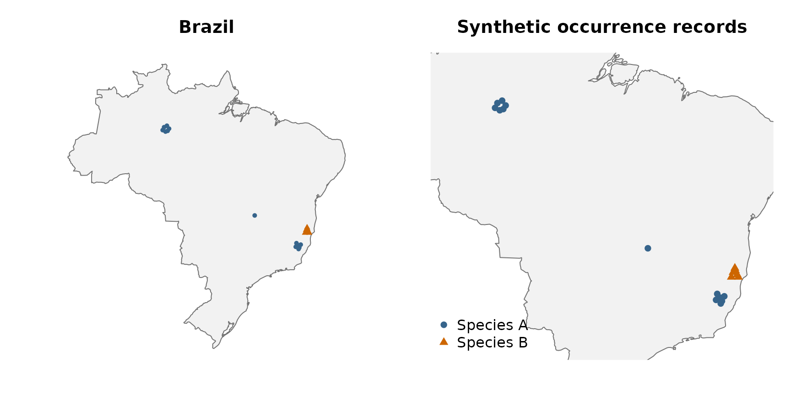
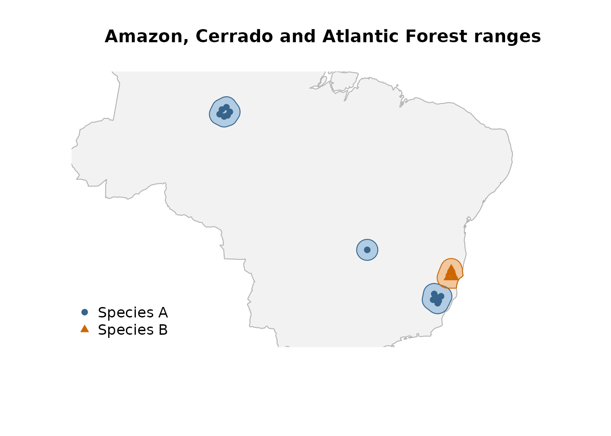
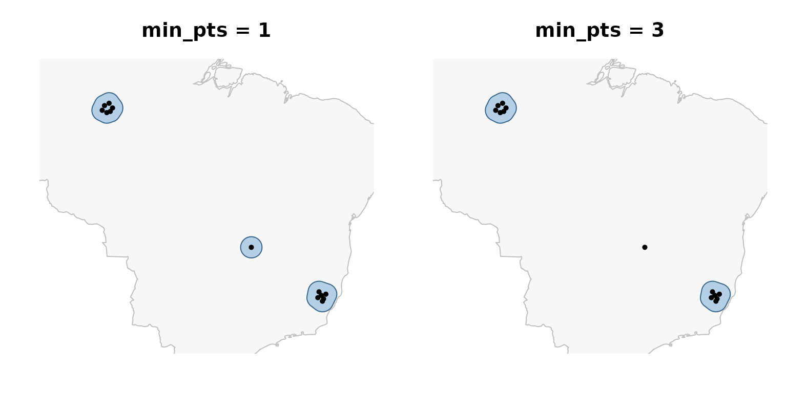
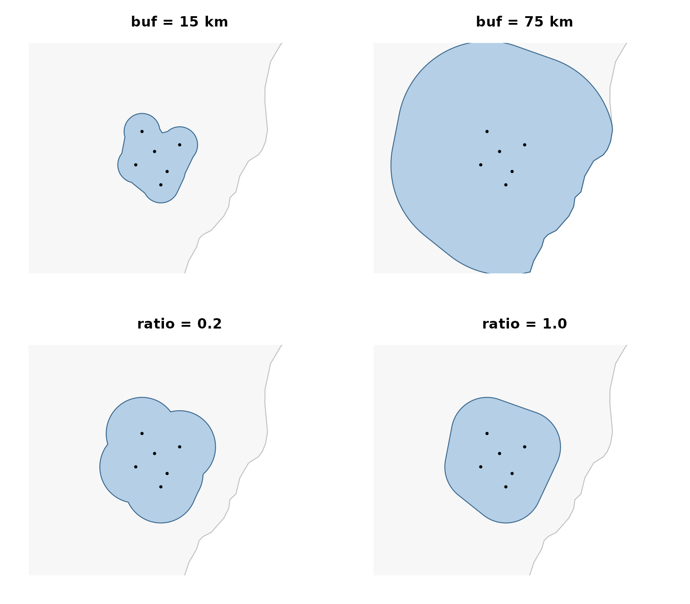
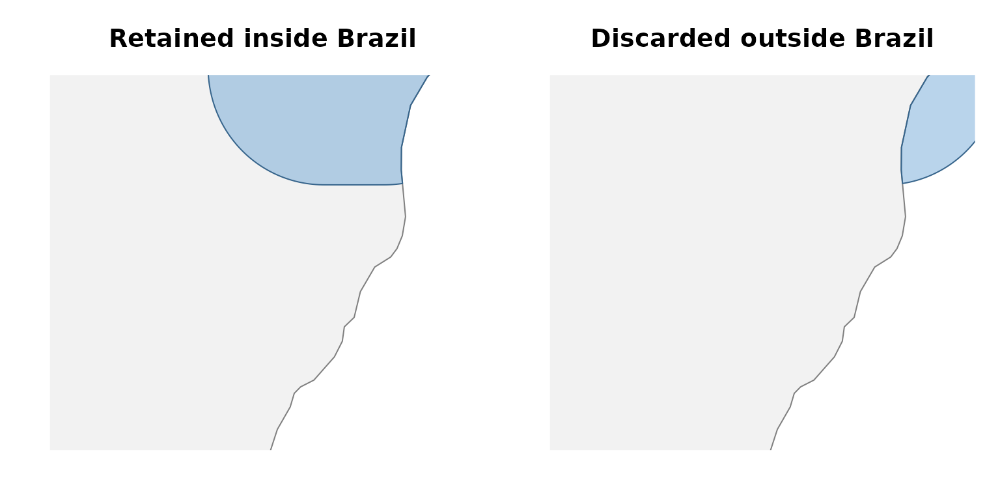
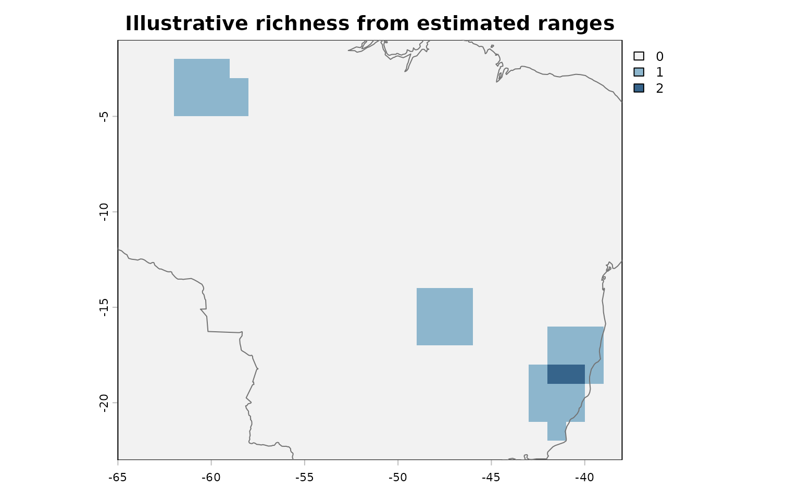
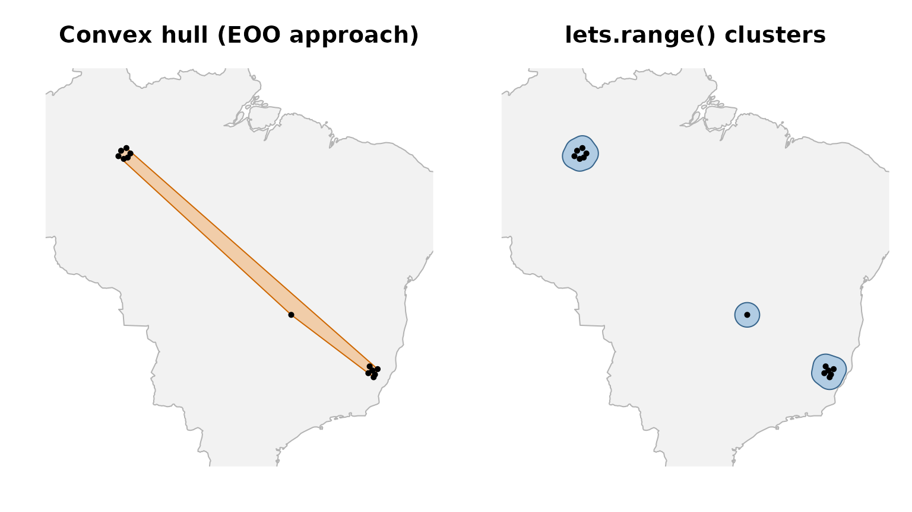

# Estimating species geographic ranges with lets.range()

## Overview

[`lets.range()`](https://brunovilela.github.io/letsR/reference/lets.range.md)
converts species occurrence records into estimated geographic range
polygons. It was designed for macroecological workflows in which
occurrence data, rather than expert-drawn range maps, are the primary
source of spatial information. The function combines geographic
clustering, buffered concave hulls, and a user-supplied spatial mask.

For each species,
[`lets.range()`](https://brunovilela.github.io/letsR/reference/lets.range.md):

1.  Validates records, rounds coordinates, removes duplicates, and
    optionally subsamples occurrences.
2.  Calculates pairwise geodesic distances and groups records using
    DBSCAN.
3.  Constructs a buffered concave hull independently for each retained
    cluster.
4.  Intersects the resulting polygons with a spatial mask, or removes
    the portions that overlap the mask.
5.  Returns an `sf` object with one `MULTIPOLYGON` feature per surviving
    species-by-cluster combination.

The estimated polygons should be interpreted as spatial approximations
of occurrence-supported ranges, not as species distribution models or
confirmed areas of occupancy. Their geometry depends on sampling
density, clustering, buffer distance, hull concavity, and the chosen
mask.

The function requires `sf` (version 1.0-11 or later), `dbscan`, and a
version of `sf` linked against GEOS 3.11.0 or later. The examples use
`letsR`, `sf`, and a Brazilian land boundary obtained with
`rnaturalearth`. We use the 1:50-million-scale Natural Earth country
dataset, available through the `rnaturalearthdata` package, so no
external map files or API credentials are needed. The records themselves
are synthetic, not observations of real species.

## Prepare reproducible occurrence records

We create two hypothetical terrestrial species with contrasting spatial
configurations across Brazil. **Species A** has a group of records in
the Amazon, another in the Atlantic Forest, and a single isolated record
in the Cerrado. **Species B** occurs only in the Atlantic Forest, partly
overlapping species A. These regions provide an illustrative
biogeographic setting, not verified records or ecological niches of real
taxa.

Each occurrence must have `scientificName`, `decimalLongitude`, and
`decimalLatitude` columns in WGS84 decimal degrees. The additional
`region` column below is used only for annotation and is ignored by
[`lets.range()`](https://brunovilela.github.io/letsR/reference/lets.range.md).

``` r

library(letsR)
#> Loading required package: terra
#> terra 1.9.50
library(sf)
#> Linking to GEOS 3.14.1, GDAL 3.12.2, PROJ 9.7.1; sf_use_s2() is TRUE

occs <- rbind(
  # Species A: an Amazonian cluster (inland Amazonas)
  data.frame(
    scientificName = "Example_species_A",
    decimalLongitude = c(-60.4, -60.0, -59.7, -60.6, -60.2, -59.9),
    decimalLatitude  = c(-3.4, -3.2, -3.6, -3.8, -4.0, -3.9),
    region = "Amazon"
  ),
  # Species A: a second cluster in the Atlantic Forest (inland Espirito Santo)
  data.frame(
    scientificName = "Example_species_A",
    decimalLongitude = c(-41.7, -41.5, -41.3, -41.8, -41.4, -41.1),
    decimalLatitude  = c(-19.3, -19.6, -19.9, -19.8, -20.1, -19.5),
    region = "Atlantic Forest"
  ),
  # Species A: one geographically isolated Cerrado record
  data.frame(
    scientificName = "Example_species_A",
    decimalLongitude = -47.6,
    decimalLatitude  = -15.5,
    region = "Cerrado"
  ),
  # Species B: records exclusively in the Atlantic Forest
  data.frame(
    scientificName = "Example_species_B",
    decimalLongitude = c(-40.35, -40.0, -39.9, -40.2, -40.5, -40.15),
    decimalLatitude  = c(-17.5, -17.7, -17.9, -17.15, -17.9, -17.35),
    region = "Atlantic Forest"
  )
)

table(occs$scientificName, occs$region)
#>                    
#>                     Amazon Atlantic Forest Cerrado
#>   Example_species_A      6               6       1
#>   Example_species_B      0               6       0
```

A spatial mask is mandatory. We use the outline of Brazil from the
1:50-million-scale Natural Earth country dataset, accessible via
`rnaturalearth` and `rnaturalearthdata`. Note that national borders are
arbitrary limits for many biological ranges (this is just a simple
example).

``` r

study_area <- rnaturalearth::ne_countries(
  country = "Brazil",
  scale = "medium",
  returnclass = "sf"
)
study_area <- study_area["admin"]

occ_points <- st_as_sf(
  occs, coords = c("decimalLongitude", "decimalLatitude"), crs = 4326
)
inside_brazil <- lengths(st_within(occ_points, study_area)) > 0L
stopifnot(all(inside_brazil))

# A national view and a closer view of the three example regions.
regional_xlim <- c(-65, -38)
regional_ylim <- c(-23, -1)
atlantic_xlim <- c(-42.7, -39.5)
atlantic_ylim <- c(-21.3, -18.1)

op <- par(mfrow = c(1, 2), mar = c(2, 2, 3, 1))
plot(st_geometry(study_area), col = "gray95", border = "gray45",
     main = "Brazil")
points(occs$decimalLongitude, occs$decimalLatitude,
       pch = ifelse(occs$scientificName == "Example_species_A", 16, 17),
       col = ifelse(occs$scientificName == "Example_species_A",
                    "steelblue4", "darkorange3"), cex = 0.7)
plot(st_geometry(study_area), xlim = regional_xlim, ylim = regional_ylim,
     col = "gray95", border = "gray45",
     main = "Synthetic occurrence records")
points(occs$decimalLongitude, occs$decimalLatitude,
       pch = ifelse(occs$scientificName == "Example_species_A", 16, 17),
       col = ifelse(occs$scientificName == "Example_species_A",
                    "steelblue4", "darkorange3"))
legend("bottomleft", legend = c("Species A", "Species B"),
       pch = c(16, 17), col = c("steelblue4", "darkorange3"), bty = "n")
```



``` r

par(op)
```

## Estimate geographic ranges

The main arguments are `occs`, `crop_shp`, `eps_m`, `min_pts`, `ratio`,
and `buf`. Distances are specified in meters, not degrees. The
`plot_map = FALSE` option suppresses the function’s automatic
species-by-species plots so that we can customize figures in the
vignette.

``` r

ranges <- lets.range(
  occs = occs,
  crop_shp = study_area,
  eps_m = 95000,       # 95 km neighborhood threshold for DBSCAN
  min_pts = 1,         # Retain even isolated occurrences
  ratio = 0.5,         # Intermediate concavity
  buf = 50000,         # 50 km buffer, applied before and after hull construction
  intersection = TRUE, # Retain only the area inside study_area
  plot_map = FALSE
)

ranges[, c("binomial", "cluster")]
#> Simple feature collection with 4 features and 2 fields
#> Geometry type: MULTIPOLYGON
#> Dimension:     XY
#> Bounding box:  xmin: -61.50014 ymin: -21.0031 xmax: -39.154 ymax: -2.295806
#> Geodetic CRS:  WGS 84
#>            binomial cluster                       geometry
#> 1 Example_species_A       1 MULTIPOLYGON (((-61.09126 -...
#> 2 Example_species_A       2 MULTIPOLYGON (((-42.42808 -...
#> 3 Example_species_A       3 MULTIPOLYGON (((-48.31453 -...
#> 4 Example_species_B       1 MULTIPOLYGON (((-40.92025 -...
st_geometry_type(ranges)
#> [1] MULTIPOLYGON MULTIPOLYGON MULTIPOLYGON MULTIPOLYGON
#> 18 Levels: GEOMETRY POINT LINESTRING POLYGON MULTIPOINT ... TRIANGLE
st_crs(ranges)$epsg
#> [1] 4326
```

With `min_pts = 1`, the Cerrado singleton can form its own cluster and,
provided `buf > 0`, yield a polygon. Cluster labels are identifiers
assigned by DBSCAN within each species, not globally unique IDs across
species. Each retained cluster occupies one row, even if its geometry
has multiple spatially disconnected components.

``` r

plot(st_geometry(study_area), xlim = regional_xlim, ylim = regional_ylim,
     col = "gray95", border = "gray70",
     main = "Amazon, Cerrado and Atlantic Forest ranges")
plot(st_geometry(ranges[ranges$binomial == "Example_species_A", ]),
     col = grDevices::adjustcolor("steelblue3", alpha.f = 0.4),
     border = "steelblue4", add = TRUE)
plot(st_geometry(ranges[ranges$binomial == "Example_species_B", ]),
     col = grDevices::adjustcolor("darkorange2", alpha.f = 0.35),
     border = "darkorange3", add = TRUE)
points(occs$decimalLongitude, occs$decimalLatitude,
       pch = ifelse(occs$scientificName == "Example_species_A", 16, 17),
       col = ifelse(occs$scientificName == "Example_species_A",
                    "steelblue4", "darkorange3"))
legend("bottomleft", legend = c("Species A", "Species B"),
       pch = c(16, 17), col = c("steelblue4", "darkorange3"), bty = "n")
```



## How clustering changes the result

DBSCAN identifies groups of geographically connected records. The
parameter `eps_m` is the neighborhood distance threshold. It is *not* a
maximum distance between every pair of records in the same cluster,
because a cluster can contain a chain of connected neighborhoods.

The parameter `min_pts` specifies the minimum local neighborhood size
(including the focal record) required to form a core point. Records
classified as noise (DBSCAN label `0`) are excluded from the range
estimate. For synthetic species A, increasing `min_pts` from 1 to 3
excludes the isolated Cerrado record while retaining its Amazonian and
Atlantic Forest clusters.

``` r

occ_A <- subset(occs, scientificName == "Example_species_A")

with_singletons <- lets.range(
  occ_A, crop_shp = study_area,
  eps_m = 95000, min_pts = 1,
  buf = 50000, ratio = 0.5,
  plot_map = FALSE
)

without_singletons <- lets.range(
  occ_A, crop_shp = study_area,
  eps_m = 95000, min_pts = 3,
  buf = 50000, ratio = 0.5,
  plot_map = FALSE
)

c(
  clusters_with_singletons = nrow(with_singletons),
  clusters_without_singletons = nrow(without_singletons)
)
#>    clusters_with_singletons clusters_without_singletons 
#>                           3                           2
```

``` r

op <- par(mfrow = c(1, 2), mar = c(2, 2, 3, 1))
for (i in seq_along(list(with_singletons, without_singletons))) {
  x <- list(with_singletons, without_singletons)[[i]]
  plot(st_geometry(study_area), xlim = regional_xlim, ylim = regional_ylim,
       col = "gray97", border = "gray75",
       main = if (i == 1) "min_pts = 1" else "min_pts = 3")
  if (nrow(x)) {
    plot(st_geometry(x), add = TRUE,
         col = grDevices::adjustcolor("steelblue3", alpha.f = 0.4),
         border = "steelblue4")
  }
  points(occ_A$decimalLongitude, occ_A$decimalLatitude, pch = 16, cex = 0.7)
}
```



``` r

par(op)
```

Use `min_pts > 1` when an isolated record should not define a range
polygon on its own. The spatial separation among the Amazon, Cerrado,
and Atlantic Forest records makes the singleton particularly clear in
this example. Choosing `eps_m` and `min_pts` requires biological
judgement and should ideally be tested in a sensitivity analysis.

## How buffer width and hull concavity change the result

The `buf` parameter controls the width of the initial buffer around each
cluster *and* a second buffer around the hull. For an isolated point,
this creates a roughly circular polygon of radius approximately
`2 * buf` before masking. Increasing `buf` generally expands estimated
ranges.

The `ratio` parameter controls the concavity of the hull, with
`ratio = 1` producing a convex hull and smaller values permitting a more
concave boundary. Because the hull is built around buffered points,
changes in `ratio` may be subtle for small or tightly clustered samples.

``` r

small_buffer <- lets.range(
  occ_A, crop_shp = study_area,
  eps_m = 95000, min_pts = 3,
  ratio = 0.5, buf = 15000, plot_map = FALSE
)

large_buffer <- lets.range(
  occ_A, crop_shp = study_area,
  eps_m = 95000, min_pts = 3,
  ratio = 0.5, buf = 75000, plot_map = FALSE
)

concave_range <- lets.range(
  occ_A, crop_shp = study_area,
  eps_m = 95000, min_pts = 3,
  ratio = 0.2, buf = 30000, plot_map = FALSE
)

convex_range <- lets.range(
  occ_A, crop_shp = study_area,
  eps_m = 95000, min_pts = 3,
  ratio = 1, buf = 30000, plot_map = FALSE
)
```

The panels below zoom into the Atlantic Forest cluster so the effects of
buffer distance and hull concavity are easier to see. The same
parameters are applied to all retained clusters, including the Amazonian
one.

``` r

options_to_plot <- list(small_buffer, large_buffer,
                        concave_range, convex_range)
plot_titles <- c("buf = 15 km", "buf = 75 km",
                 "ratio = 0.2", "ratio = 1.0")
op <- par(mfrow = c(2, 2), mar = c(2, 2, 3, 1))
for (i in seq_along(options_to_plot)) {
  plot(st_geometry(study_area), xlim = atlantic_xlim, ylim = atlantic_ylim,
       col = "gray97", border = "gray75",
       main = plot_titles[i])
  plot(st_geometry(options_to_plot[[i]]), add = TRUE,
       col = grDevices::adjustcolor("steelblue3", alpha.f = 0.4),
       border = "steelblue4")
  points(occ_A$decimalLongitude, occ_A$decimalLatitude, pch = 16, cex = 0.6)
}
```



``` r

par(op)
```

## Restrict ranges to Brazilian land

`crop_shp` accepts an `sf` or `sfc` object with a known coordinate
reference system. With `intersection = TRUE`,
[`lets.range()`](https://brunovilela.github.io/letsR/reference/lets.range.md)
retains only parts of the estimated polygons inside the mask. With
`intersection = FALSE`, it retains only parts *outside* the mask. The
latter option is useful, for example, for excluding land from the
estimated ranges of marine species. Here, all of our synthetic
occurrence records are terrestrial and fall on Brazilian land.

The example below illustrates how the same Brazilian mask partitions an
estimated range into the part inside Brazil and the part discarded
outside Brazil. Any discarded fragment should be interpreted as a
geometric artifact of the buffer and hull, **not** evidence that a
terrestrial species occupies the ocean.

``` r

occ_B <- subset(occs, scientificName == "Example_species_B")

inside_land <- lets.range(
  occ_B, crop_shp = study_area,
  intersection = TRUE,
  eps_m = 95000, min_pts = 1, ratio = 0.5,
  buf = 60000, plot_map = FALSE
)

outside_land <- lets.range(
  occ_B, crop_shp = study_area,
  intersection = FALSE,
  eps_m = 95000, min_pts = 1, ratio = 0.5,
  buf = 60000, plot_map = FALSE
)

op <- par(mfrow = c(1, 2), mar = c(2, 2, 3, 1))
for (i in 1:2) {
  plot(st_geometry(study_area), xlim = atlantic_xlim, ylim = atlantic_ylim,
       col = "gray95", border = "gray50",
       main = if (i == 1) "Retained inside Brazil" else "Discarded outside Brazil")
  x <- if (i == 1) inside_land else outside_land
  if (nrow(x) > 0L) {
    plot(st_geometry(x), add = TRUE,
         col = grDevices::adjustcolor("steelblue3", alpha.f = 0.4),
         border = "steelblue4")
  }
  points(occ_B$decimalLongitude, occ_B$decimalLatitude,
         pch = 17, cex = 0.7, col = "darkorange3")
}
```



``` r

par(op)
```

The country boundary removes estimated area in neighboring countries as
well as the ocean. For a wide-ranging terrestrial species, a global land
mask or a biologically motivated geographic domain may therefore be
preferable.

## Work with the output: from multiple ranges to a presence-absence matrix

[`lets.range()`](https://brunovilela.github.io/letsR/reference/lets.range.md)
returns an `sf` object with `binomial`, `cluster`, and `geometry`
columns in EPSG:4326. Each cluster is a `MULTIPOLYGON` feature. Thus,
species A contributes several polygon rows, whereas species B
contributes one. We can summarize cluster areas, combine polygons
belonging to the same species, and use the result directly in a `letsR`
presence-absence workflow.

``` r

ranges$area_km2 <- as.numeric(st_area(ranges)) / 1e6

ranges_summary <- st_drop_geometry(ranges)[,
  c("binomial", "cluster", "area_km2")
]
print(ranges_summary)
#>            binomial cluster area_km2
#> 1 Example_species_A       1 64953.66
#> 2 Example_species_A       2 60358.55
#> 3 Example_species_A       3 31517.17
#> 4 Example_species_B       1 51880.66

# Combine all retained clusters of each species into a single geometry.
species_ranges <- do.call(
  rbind,
  lapply(split(ranges, ranges$binomial), function(x) {
    st_sf(
      binomial = x$binomial[1],
      geometry = st_union(st_geometry(x))
    )
  })
)

# There should now be one feature per species.
stopifnot(nrow(species_ranges) == length(unique(occs$scientificName)))
species_ranges
#> Simple feature collection with 2 features and 1 field
#> Geometry type: GEOMETRY
#> Dimension:     XY
#> Bounding box:  xmin: -61.50014 ymin: -21.0031 xmax: -39.154 ymax: -2.295806
#> Geodetic CRS:  WGS 84
#>                            binomial                       geometry
#> Example_species_A Example_species_A MULTIPOLYGON (((-48.32991 -...
#> Example_species_B Example_species_B POLYGON ((-40.93575 -16.589...
```

The resulting `species_ranges` object contains two species and can be
passed to
[`lets.presab()`](https://brunovilela.github.io/letsR/reference/lets.presab.md)
to construct a grid-based presence-absence matrix. A cell is assigned a
presence when it intersects an estimated range polygon (the default
`cover = 0` convention). We use a one-degree grid for a simple
macroecological illustration, not as a recommended resolution for local
occupancy studies.

``` r

pam <- lets.presab(
  shapes = species_ranges,
  xmn = -65, xmx = -38,
  ymn = -23, ymx = -1,
  resol = 1,
  remove.cells = TRUE,
  remove.sp = TRUE,
  cover = 0
)

# Matrix: cell centroids followed by one 0/1 column per species.
head(pam$Presence_and_Absence_Matrix)
#>      Longitude(x) Latitude(y) Example_species_A Example_species_B
#> [1,]        -61.5        -2.5                 1                 0
#> [2,]        -60.5        -2.5                 1                 0
#> [3,]        -59.5        -2.5                 1                 0
#> [4,]        -61.5        -3.5                 1                 0
#> [5,]        -60.5        -3.5                 1                 0
#> [6,]        -59.5        -3.5                 1                 0

# Frequency of cells containing one or two species.
cell_richness <- rowSums(
  pam$Presence_and_Absence_Matrix[, -(1:2), drop = FALSE]
)
print(table(cell_richness))
#> cell_richness
#>  1  2 
#> 35  2

# Spatial richness is stored as a terra raster.
terra::plot(pam$Richness_Raster,
            col = c("gray95", "lightskyblue3", "steelblue4"),
            main = "Illustrative richness from estimated ranges")
plot(st_geometry(study_area), border = "gray45", col = NA, add = TRUE)
```



Species richness and co-occurrence in this grid reflect the inferred
polygons, not independent field observations. The overlap between
species A and B in the Atlantic Forest should produce cells with
estimated richness of two. Changing clustering, buffering, or resolution
can change those cells.

## IUCN extent of occurrence and `lets.range()`: different purposes

IUCN Red List assessments commonly use **extent of occurrence (EOO)** to
characterize the spatial spread of a taxon’s current occurrences. The
standard geometric estimator is a **minimum convex polygon (MCP)** that
encloses all relevant known, inferred, or projected occurrence sites,
with specific rules and exceptions under IUCN guidance. The MCP can span
extensive unoccupied areas between disjunct populations. This is
intentional: EOO is a measure of geographic spread relevant to assessing
extinction risk, not a map of continuous occupancy.

An **IUCN distribution or range map** is not simply the same thing as an
EOO polygon. Depending on the taxon and available information, IUCN maps
may incorporate expert interpretation, habitat, barriers, seasonality,
and other information. Our comparison focuses specifically on the
geometric MCP approach to illustrating EOO versus the clustered polygons
produced by
[`lets.range()`](https://brunovilela.github.io/letsR/reference/lets.range.md).

``` r

occ_A_sf <- st_as_sf(
  occ_A,
  coords = c("decimalLongitude", "decimalLatitude"),
  crs = 4326
)

# An illustrative equal-area projection covering the Brazilian example.
brazil_equal_area <- paste(
  "+proj=aea +lat_1=-5 +lat_2=-25 +lat_0=-15",
  "+lon_0=-48 +datum=WGS84 +units=m +no_defs"
)

projected_points <- st_transform(occ_A_sf, brazil_equal_area)
eoo_hull <- st_convex_hull(st_union(st_geometry(projected_points)))
eoo_km2 <- as.numeric(st_area(eoo_hull)) / 1e6

# lets.range() retains disconnected clusters after the Brazil land mask.
range_area_km2 <- as.numeric(st_area(st_union(st_geometry(with_singletons)))) / 1e6
comparison <- data.frame(
  estimate = c("Illustrative MCP-based EOO", "lets.range() polygon area"),
  area_km2 = round(c(eoo_km2, range_area_km2))
)
print(comparison)
#>                     estimate area_km2
#> 1 Illustrative MCP-based EOO   252555
#> 2  lets.range() polygon area   156829

op <- par(mfrow = c(1, 2), mar = c(2, 2, 3, 1))
plot(st_geometry(study_area), xlim = regional_xlim, ylim = regional_ylim,
     col = "gray95", border = "gray70", main = "Convex hull (EOO approach)")
plot(st_transform(eoo_hull, 4326), add = TRUE,
     col = grDevices::adjustcolor("darkorange2", alpha.f = 0.3),
     border = "darkorange3")
points(occ_A$decimalLongitude, occ_A$decimalLatitude, pch = 16, cex = 0.7)

plot(st_geometry(study_area), xlim = regional_xlim, ylim = regional_ylim,
     col = "gray95", border = "gray70", main = "lets.range() clusters")
plot(st_geometry(with_singletons), add = TRUE,
     col = grDevices::adjustcolor("steelblue3", alpha.f = 0.4),
     border = "steelblue4")
points(occ_A$decimalLongitude, occ_A$decimalLatitude, pch = 16, cex = 0.7)
```



``` r

par(op)
```

The convex hull for species A connects the Amazonian and Atlantic Forest
records, along with the Cerrado singleton. It therefore encloses a large
region where no occurrences were provided.
[`lets.range()`](https://brunovilela.github.io/letsR/reference/lets.range.md)
instead preserves separate occurrence-supported range components. The
two reported areas are **not interchangeable**.

### Choosing an approach

- **Use IUCN-compliant EOO procedures** when evaluating extinction risk
  or reporting spatial metrics for a Red List assessment. Follow the
  current IUCN criteria on record inclusion, biologically appropriate
  interpretation, and exceptional spatial configurations. The example
  above is illustrative, not a formal Red List assessment.
- **Use vetted IUCN distribution maps** when their coverage, spatial
  attributes, assessment date, and expert evidence are appropriate to
  the conservation or broad-scale biogeographic question. A mapped range
  does not imply presence in every constituent grid cell.
- **Use
  [`lets.range()`](https://brunovilela.github.io/letsR/reference/lets.range.md)**
  when consistent, reproducible, occurrence-based approximations of
  potentially disjunct ranges are needed for exploratory macroecology or
  downstream analyses such as presence-absence matrices. It should not
  be described as an IUCN EOO estimator or treated as verified habitat
  or occupancy.

Both occurrence-based estimation and expert mapping may be affected by
uneven sampling, incomplete knowledge, and spatial generalization. No
method reliably reconstructs an entire species range from sparse points
without additional assumptions.

For methodological guidance, see the [IUCN Red List Mapping
Standards](https://nrl.iucnredlist.org/resources/mappingstandards) and
the [IUCN Red List Categories and Criteria
Guidelines](https://nrl.iucnredlist.org/resources/redlistguidelines).

## Recommendations and limitations

- Select `eps_m` according to the dispersal scale, spatial
  discontinuities, and study objectives. Large thresholds may connect
  biologically distinct regions through chains of records.
- Treat `buf` as an explicit modeling assumption about the distance
  between known occurrences and the inferred range boundary. Remember
  that buffering occurs twice.
- Examine the impact of `min_pts` on rare species and unevenly sampled
  taxa. With `min_pts = 1`, even a single valid record can produce a
  range polygon.
- Set a seed with [`set.seed()`](https://rdrr.io/r/base/Random.html) if
  a species may exceed `n_max`, since the function randomly subsamples
  its occurrence records.
- Use a biologically justified mask. `crop_shp` is required. The Brazil
  boundary used here is a political/geographic constraint, not a
  species’ ecological limit. Its use can exclude genuine ranges
  extending into neighboring countries or misrepresent fine-scale
  coastal boundaries.
- The function computes metric buffers in a local azimuthal equidistant
  projection. For geographically extensive clusters, projection
  distortion may increase. The antimeridian is handled explicitly, but
  global-scale ranges still require careful inspection.
- These polygons reflect the spatial configuration of supplied records
  and should not be interpreted as corrected for sampling bias,
  dispersal limitation, or environmental suitability.

For full argument documentation, see
[`?lets.range`](https://brunovilela.github.io/letsR/reference/lets.range.md).

## Citation

If you use `letsR` in published research, please cite the package papers
reported by `citation("letsR")`.
